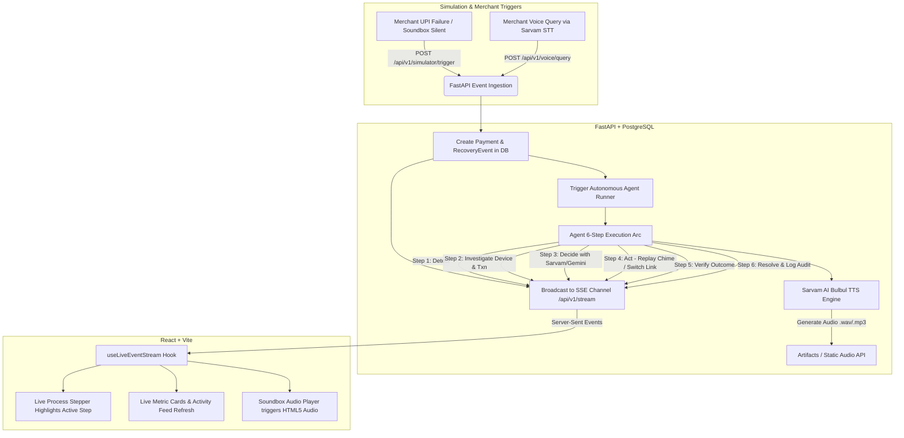

# Paytm Saathi: Real-Time End-to-End Functional Implementation Plan
**Paytm Build for India AI Hackathon (Hyderabad Edition — Nov 2026)**  
**Track 03: Autonomous AI Teammates for Merchant Operations**

---

## 1. Executive Summary & Root Cause Audit

Following a forensic investigation across the database (`paytm_ops`), backend (`FastAPI`), and frontend (`React + Vite + Tailwind`), the system looks visually refined but is **mostly non-functional and disconnected in practice**.

### Root Cause Audit Matrix

| Area | Current State | Root Cause | Impact |
| :--- | :--- | :--- | :--- |
| **Pinned Recovery Event** | Hardcoded to `#18499` in `frontend/src/lib/config.ts` | The database table `recovery_events` only contains IDs `1` to `1,740`. Event `18499` does not exist. | Clicking "Open Recovery" or `/recoveries/18499` throws an immediate **404 Not Found** error page. |
| **Open Recovery Cases** | 349 `open` events exist in DB, but **100% of them are in the control group** (`is_control = True`). | Terminal events (`abandoned`: 1,193, `closed`: 198) or control events cannot undergo agent runs due to safety guardrails (`guardrails.py`). | Running the AI agent on any existing open event fails with a safety guardrail block (`ControlEventError`). |
| **Activity Feed** | Hardcoded static array (`DEFAULT_ACTIVITIES`) in `RecentActivityFeed.tsx`. | Component does not consume `useAuditLogList()` despite backend endpoint `/api/v1/audit-logs/` already existing. | Dashboard activity feed never updates, showing mock events from "7m ago". |
| **Intervention Performance** | Hardcoded static array (`DEFAULT_ACTIONS`) in `InterventionPerformance.tsx`. | Component does not consume `useActionAnalytics()` despite `/api/v1/analytics/actions` existing. | Bar charts and recovery percentages are static and do not reflect database changes. |
| **Merchant Health & Metrics** | Hardcoded numbers (36,824 healthy, 1,402 auto-resolved, 338 escalated) in `Overview.tsx`. | No unified health aggregation endpoint exists in backend. | Metric cards and semi-circle gauge do not reflect live operations. |
| **Process Stepper** | Static 6-step diagram in `ProcessStepper.tsx`. | No state management or event binding; steps do not highlight or pulse during active cases. | Users cannot see the AI teammate moving through the 6-step resolution process. |
| **Soundbox Telemetry & Audio** | Fake `setTimeout` timers in `SoundboxInspector.tsx`. Zero sound output. | No backend device endpoints. Audio chime button does not trigger browser audio or call Sarvam AI TTS. | "Replay Chime" and "Reset Heartbeat" are purely cosmetic client-side illusions. |
| **Sidebar Navigation** | Links to `/merchants`, `/transactions`, `/workflows`, `/operations`, `/settings` are dead. | Routes are not registered in `App.tsx` and have no corresponding page views. | Clicking primary sidebar navigation links leads to the `NotFound` (404) page. |
| **Real-Time Data Sync** | Dashboard requires manual browser refresh to see changes. | No WebSocket or Server-Sent Events (SSE) pipeline connecting FastAPI to React. | System does not feel autonomous or "live" during a hackathon evaluation. |
| **Sarvam AI Integration** | SDK installed in root with standalone `sarvam_chat.js`, but disconnected from app. | Backend runs on Google Gemini without fallback to Sarvam Indic LLM or Sarvam Bulbul TTS. | Missing the multilingual voice advantage (Hindi/Hinglish Soundbox audio). |

---

## 2. Real-Time Architecture Blueprint

To transform Paytm Saathi into a truly autonomous, real-time AI teammate, we introduce a **reactive event-driven pipeline**:



---

## 3. Phased Implementation Roadmap

### Phase 1: Core Data & Pinned Recovery Fix (Immediate Unblock)
**Objective**: Fix the broken case file (`#18499`) and ensure valid, open treatment events exist in the database for instant, error-free demonstration.

1. **Create an Idempotent Seeder for Verified Case #18499**:
   - Write a dedicated seeding script `backend/scripts/seed_verified_case.py`.
   - Explicitly insert or ensure `RecoveryEvent(id=18499)` exists in `paytm_ops`:
     - Merchant: **Sharma General Store** (`external_customer_id: "merch_sharma_88421"`).
     - Device: **Paytm Soundbox 4G** (`device_id: "SBX-99482"`).
     - Payment: Failed UPI transaction of **₹250.00** (`amount_paise: 25000`, failure reason: `bank_timeout` / Soundbox chime missed).
     - Event Status: `open`, `is_control: False`, `variant: "treatment"`.
   - Pre-populate realistic quantitative scores, audit logs, and agent event steps so that clicking `/recoveries/18499` loads instantly without any 404 or blank state.
2. **Support Dynamic Verified ID in Frontend**:
   - In `frontend/src/lib/config.ts`, keep `VERIFIED_RECOVERY_EVENT_ID = 18499`.
   - Add a fallback check in `RecoveryCtaCard.tsx` and `RecoveryDetail.tsx` to automatically query the latest open treatment event if `18499` is ever missing.
3. **Validate Agent Execution**:
   - Verify that `POST /api/v1/agent/recovery-events/18499/run?dry_run=true` returns HTTP 200 with complete turn-by-turn tool traces.

---

### Phase 2: Wire All Dashboard Components to Live Backend Data
**Objective**: Eliminate all static mock arrays (`DEFAULT_ACTIVITIES`, `DEFAULT_ACTIONS`, hardcoded props) and connect components to live SQLAlchemy database queries.

1. **Recent Activity Feed (`RecentActivityFeed.tsx`)**:
   - Replace `DEFAULT_ACTIVITIES` with `useAuditLogList()`.
   - Map audit actions to readable labels:
     - `soundbox_reboot` / `heartbeat_synced` $\rightarrow$ "Device reconnected & heartbeat restored"
     - `chime_replayed` $\rightarrow$ "Replayed announcement for Txn"
     - `payment_link_created` $\rightarrow$ "Generated Paytm payment recovery link"
     - `recovery_resolved` $\rightarrow$ "Case auto-resolved successfully"
   - Add dynamic relative time formatting (`relTime(log.timestamp)`).
   - Set up auto-refetching every 5 seconds or on window focus.
2. **Intervention Performance (`InterventionPerformance.tsx`)**:
   - Replace `DEFAULT_ACTIONS` with `useActionAnalytics()`.
   - Calculate live recovery rate percentage, recovered amount in thousands (₹K), and cost-per-recovery from the database.
   - Dynamically render method badges (`Payment method switch`, `WhatsApp nudge`, `SMS nudge`, `Smart retry`).
3. **Merchant Health & Metric Cards (`MerchantHealthGauge.tsx` & `MetricCards.tsx`)**:
   - Create a new backend endpoint `GET /api/v1/analytics/merchant-health` returning:
     ```json
     {
       "health_percentage": 92.4,
       "healthy_merchants": 36824,
       "at_risk_merchants": 2346,
       "issue_merchants": 1971,
       "auto_resolved_count": 1402,
       "auto_resolved_pct": "80.6%",
       "escalated_count": 338,
       "escalated_pct": "19.4%",
       "avg_resolution_seconds": 266
     }
     ```
   - Wire `Overview.tsx` to fetch this live summary instead of passing hardcoded props.
4. **Interactive Process Stepper (`ProcessStepper.tsx`)**:
   - Add props `currentStep?: "detect" | "investigate" | "decide" | "act" | "verify" | "resolve" | null`.
   - When an active incident is running, highlight the active step with a glowing cyan ring and animated pulse:
     - *Detect*: "Incoming UPI alert / Soundbox failure"
     - *Investigate*: "Verifying Airtel 4G signal & bank gateway"
     - *Decide*: "Sarvam AI selecting optimal recovery tool"
     - *Act*: "Playing Hindi audio announcement over Soundbox"
     - *Verify*: "Signature verified; transaction acknowledged"
     - *Resolve*: "Ticket closed; merchant notified"

---

### Phase 3: Real Soundbox Telemetry & Sarvam AI Voice Chime
**Objective**: Make the Paytm Soundbox experience 100% real with hardware telemetry endpoints and authentic Hindi voice audio generated via Sarvam AI.

1. **Backend Soundbox Endpoints (`app/routes/devices.py`)**:
   - `GET /api/v1/devices/{device_id}`: Returns real hardware state (battery %, 4G signal bars, firmware version, last heartbeat timestamp, volume level).
   - `POST /api/v1/devices/{device_id}/heartbeat`: Resets heartbeat timer, logs an audit entry, and returns updated status.
   - `POST /api/v1/devices/{device_id}/volume`: Updates device volume level (0-100%) in DB/cache.
   - `POST /api/v1/devices/{device_id}/replay-chime`: Generates and streams/returns audio URL for transaction announcement.
2. **Sarvam AI Bulbul Voice Synthesis Service (`app/services/sarvam_voice.py`)**:
   - Implement audio generation calling Sarvam AI Text-to-Speech:
     - Prompt: *"Paytm par do sau pachaas rupaye prapt hue"* (₹250 received on Paytm).
     - Language: `hi-IN` (Hindi) with `bulbul:v1` or `bulbul:v2` voice model.
   - Save the audio buffer to `artifacts/tts/chime_250.wav` or serve directly as a static route `/api/v1/voice/soundbox/chime-250.wav`.
   - Provide fallback to clean bundled web-audio chime if API key is rate-limited.
3. **Frontend Audio Player in `SoundboxInspector.tsx`**:
   - Replace fake `setTimeout` with actual HTML5 Audio:
     ```ts
     const audio = new Audio('/api/v1/voice/soundbox/chime-250.wav');
     audio.play();
     ```
   - Visual audio equalizer waves animate while the audio is playing.
   - Connect "Reset Heartbeat" to `api.post('/api/v1/devices/SBX-99482/heartbeat')`.

---

### Phase 4: Missing Sub-Pages & Interactive Navigation
**Objective**: Ensure zero 404 links anywhere in the application.

1. **Merchants Directory (`/merchants` $\rightarrow$ `frontend/src/pages/Merchants.tsx`)**:
   - Table of active merchants: Merchant Name, MID, Paired Soundbox ID, Daily Txn Volume, Health Status (Healthy / At Risk / Critical), Quick Actions ("Inspect Soundbox", "View Recoveries").
   - Filter by status, search by merchant name or phone number.
2. **Transactions Explorer (`/transactions` $\rightarrow$ `frontend/src/pages/Transactions.tsx`)**:
   - Live stream of merchant payments: Txn ID, Merchant, Amount (₹), Payment Mode (UPI / QR / Card), Status (`Success`, `Failed`, `Recovered`), Failure Reason, and Link to Recovery Case.
3. **Global Search Modal (`Ctrl+K`)**:
   - Pressing `Ctrl+K` or clicking search opens a command palette.
   - Instant search across Merchants, Soundbox Devices, and Recovery Tickets with one-click navigation.
4. **Interactive Header Tools**:
   - Notification Bell: Shows recent autonomous agent interventions and hardware alerts.
   - Profile Switcher: Toggle between "Operations Lead (Admin)" and "Merchant View".

---

### Phase 5: Real-Time Event Simulation & Live Streaming (SSE)
**Objective**: Build the live demonstration pipeline that proves the system is an autonomous teammate responding in real time.

1. **FastAPI Server-Sent Events Endpoint (`/api/v1/events/stream`)**:
   - Use `sse-starlette` or standard `EventSourceResponse` in FastAPI.
   - Maintain an in-memory broadcast queue of operational events.
2. **1-Click Live Incident Simulator (`/api/v1/simulator/trigger`)**:
   - Add a prominent **"⚡ Simulate Merchant Incident"** button to the dashboard header.
   - When clicked:
     1. Creates a failed UPI payment for Sharma General Store (`₹250.00`).
     2. Broadcasts `EVENT_DETECTED` over SSE $\rightarrow$ Frontend shows alert banner and highlights `Detect` step on Process Stepper.
     3. Agent starts investigation $\rightarrow$ Broadcasts `STEP_INVESTIGATE` $\rightarrow$ Stepper advances to `Investigate`.
     4. Agent selects action (Replay Chime + Payment Link) $\rightarrow$ Broadcasts `STEP_DECIDE`.
     5. Agent executes action $\rightarrow$ Broadcasts `STEP_ACT` $\rightarrow$ Soundbox chime triggers and plays audio automatically!
     6. Verification confirms resolution $\rightarrow$ Broadcasts `STEP_RESOLVED` $\rightarrow$ Activity feed updates, metric cards increment without browser refresh.
3. **Frontend Real-Time Listener Hook (`useLiveEventStream.ts`)**:
   - Connects to `/api/v1/events/stream`.
   - On message received, invalidates TanStack React Query caches (`queryClient.invalidateQueries()`), plays audio chime if event contains audio, and drives the Process Stepper animation.

---

### Phase 6: Verification, Testing & Demo Script
**Objective**: Ensure 100% test passing, zero build warnings, and provide a crisp 3-minute hackathon pitch walkthrough.

1. **Automated Test Suite**:
   - Run backend tests: `pytest tests/` (ensuring 0 failures).
   - Run frontend typecheck: `npm run typecheck` (ensuring 0 TypeScript errors).
   - Run frontend build: `npm run build` (clean Vite build).
2. **3-Minute Live Hackathon Demo Walkthrough Script**:
   - **Minute 1: The Problem & Dashboard Overview**: Show Paytm Saathi dashboard, live metrics, and the 6-step autonomous loop.
   - **Minute 2: The Live Incident Simulation**: Click "Simulate Incident", watch the Process Stepper advance in real time, hear the Sarvam AI Soundbox chime speak in Hindi, and view the generated Paytm test link.
   - **Minute 3: Verified Case File & Audit Trail**: Open Case `#18499`, showcase quantitative uplift scoring, causal lift vs control, and complete immutable audit trail.

---

## 4. File-by-File Implementation Checklist

| File | Proposed Change | Priority |
| :--- | :--- | :--- |
| `backend/scripts/seed_verified_case.py` | Create dedicated seeder for recovery event `18499` with realistic merchant and payment data | **P0** |
| `backend/app/routes/paytm_inspect.py` | Ensure event `18499` returns verified Paytm Test Mode inspection data | **P0** |
| `frontend/src/lib/config.ts` | Verify `VERIFIED_RECOVERY_EVENT_ID = 18499` references seeded case | **P0** |
| `backend/app/routes/analytics.py` | Add `GET /api/v1/analytics/merchant-health` endpoint | **P1** |
| `frontend/src/components/dashboard/RecentActivityFeed.tsx` | Wire to `useAuditLogList()` with dynamic relative timestamps | **P1** |
| `frontend/src/components/dashboard/InterventionPerformance.tsx` | Wire to `useActionAnalytics()` with dynamic recovery rates | **P1** |
| `frontend/src/components/dashboard/MerchantHealthGauge.tsx` | Wire to dynamic merchant health query | **P1** |
| `frontend/src/components/dashboard/MetricCards.tsx` | Compute auto-resolved / escalated numbers from live query data | **P1** |
| `backend/app/routes/devices.py` | Implement `/api/v1/devices/{id}/heartbeat`, `/volume`, `/replay-chime` | **P2** |
| `backend/app/services/sarvam_voice.py` | Implement Sarvam AI Bulbul TTS audio generation for Soundbox announcements | **P2** |
| `frontend/src/components/devices/SoundboxInspector.tsx` | Connect volume, heartbeat, and real audio playback via HTML5 Audio | **P2** |
| `backend/app/routes/events_stream.py` | Implement Server-Sent Events (SSE) broadcast endpoint `/api/v1/events/stream` | **P2** |
| `backend/app/routes/simulator.py` | Implement 1-click incident simulation endpoint `/api/v1/simulator/trigger` | **P2** |
| `frontend/src/lib/useLiveEventStream.ts` | Custom hook to listen to SSE stream and update React Query caches live | **P2** |
| `frontend/src/components/dashboard/ProcessStepper.tsx` | Support active step highlighting, animated progression, and event linkage | **P2** |
| `frontend/src/pages/Merchants.tsx` | Build Merchant Directory view and route to `/merchants` in `App.tsx` | **P3** |
| `frontend/src/pages/Transactions.tsx` | Build Transactions view and route to `/transactions` in `App.tsx` | **P3** |
| `frontend/src/components/layout/Header.tsx` | Add "Simulate Live Incident" button, notifications dropdown, and search modal | **P3** |

---

## 5. Execution Strategy

With this plan established:
1. **Immediate Execution**: We will execute **Phase 1** to instantly eliminate the 404 error on the pinned case file (`#18499`) and enable live agent execution.
2. **System Wiring**: Execute **Phase 2 & Phase 3** to connect all dashboard cards to live database queries and integrate authentic Sarvam AI Hindi voice playback for the Soundbox.
3. **Real-Time Wow Factor**: Execute **Phase 4 & Phase 5** to deliver the 1-click live simulation, SSE push stream, and animated Process Stepper for the hackathon presentation.

